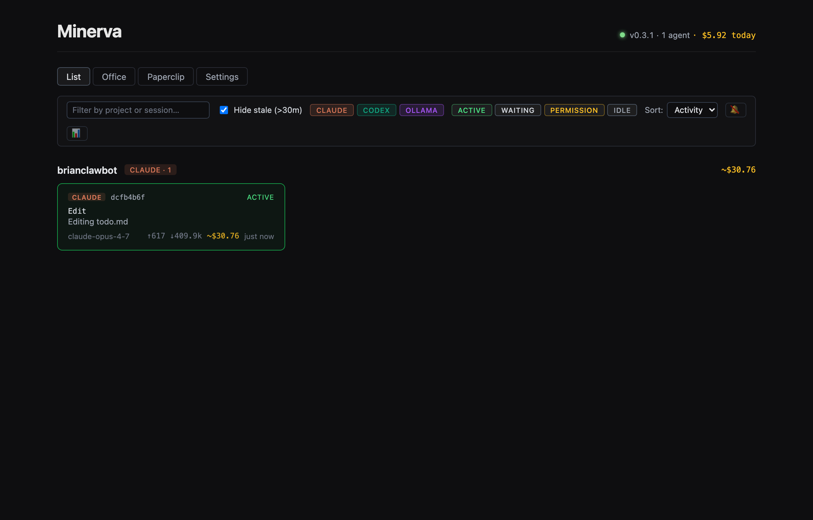
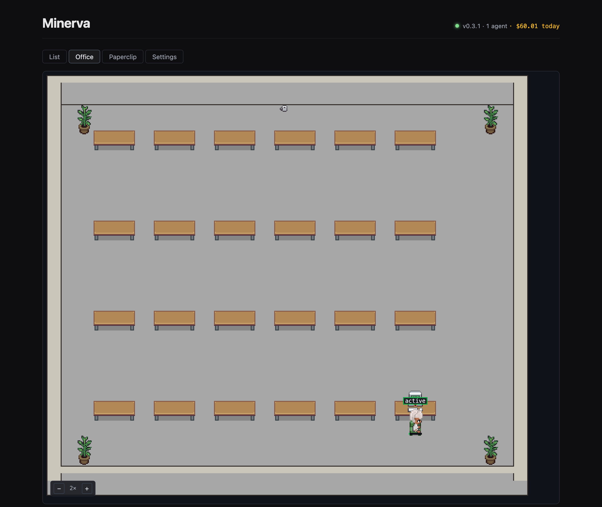

## The problem

I run several AI coding agents at once: Claude Code in one repo, Codex in another, a local model on Ollama. Each one keeps its state in its own place, either a transcript file or a local API. I couldn't see in one view what each agent was doing, what it was costing, or whether it had stalled waiting for me.

## What I built

Minerva is a local dashboard that **observes** agents and never controls them. It reads their transcripts as read-only files and binds only to `127.0.0.1`.

- **Observation providers.** Three standalone packages turn each agent's native output into one shared snapshot format. One is a state machine over Claude Code's transcript JSONL, one reads Codex CLI rollouts, and one polls Ollama's `/api/ps`.
- **List view.** Live cards grouped by repo. Each shows the current tool, model, git branch, input/output tokens, estimated USD spend, and a 30-minute activity sparkline, plus a running "$X.XX today" total.
- **Office view.** A pixel-art office where each agent gets a stable desk (hashed by session id), so I can see at a glance who is working and who is idle.
- **Pipeline.** A `spec → plan → build → test → review → ship` workflow encoded as a template on the orchestration runtime. Each stage writes a Markdown artifact into the workspace.

## Under the hood

An Express + Drizzle server on embedded Postgres, with a Svelte 5 (runes) UI streamed over WebSockets. It grew out of two earlier projects of mine, a Python pipeline and a pixel-art agent dashboard, which I merged onto an MIT-licensed orchestration runtime. Telemetry is off by default. A boot-time check confirms on every release branch that the daemon listens only on loopback.

## Results

Minerva is now how I run my own work: 2,500+ commits across four phases, with every slice tracked, reviewed, and shipped through the same pipeline it implements.
